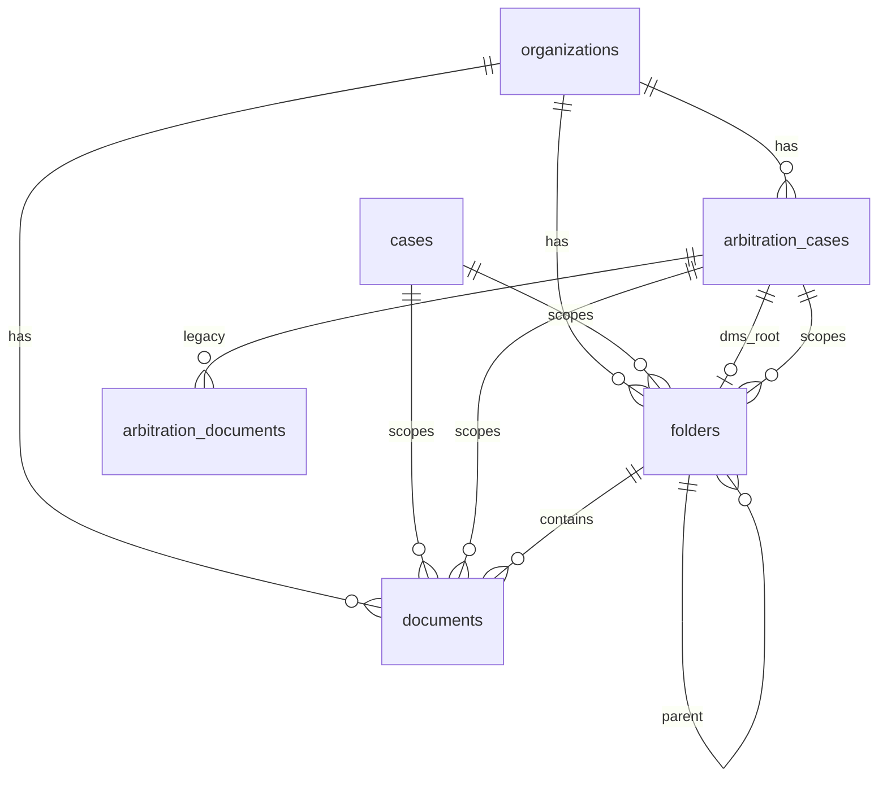

# Database Schema

Database Engine: PostgreSQL  
ORM: Spring Data JPA / Hibernate  
Migration Tool: Flyway  
**Current Version: V13**

Kaynak: `FMS_BackEnd/src/main/resources/db/migration/`  
Entity: `com.lawoffice.fms.*.domain`  
Şablon: `08_TEMPLATES/DATABASE_TEMPLATE.md`

Son senkron: 2026-09-16

---

## Naming Standards

- Tablolar: snake_case, çoğul (`clients`, `cases`, `folders`)
- Kolonlar: snake_case
- PK: UUID
- FK: `{entity}_id`
- Soft delete: `deleted` (boolean), `deleted_at` (timestamp)
- Multi-tenant: `organization_id` (UUID) — V3+
- Optimistic lock: `version` (BIGINT)

---

## Base / Ortak Alanlar

Çoğu tabloda (V1 + SaaS kolonları):

| Kolon | Tip | Not |
|-------|-----|-----|
| `id` | UUID PK | |
| `created_at` / `updated_at` | TIMESTAMP | |
| `created_by` / `updated_by` | VARCHAR(255) | nullable |
| `version` | BIGINT | default 0 |
| `deleted` | BOOLEAN | default false |
| `deleted_at` | TIMESTAMP | nullable |
| `organization_id` | UUID FK → organizations | V3+; Hibernate `organizationFilter` |

Entity tarafı: `BaseEntity` + `@SQLRestriction("deleted = false")`.

---

## Core Tables (özet)

| Tablo | Amaç |
|-------|------|
| `users`, `roles`, `permissions`, `role_permissions`, `user_roles` | Auth / RBAC |
| `refresh_tokens` | JWT refresh |
| `clients`, `client_contacts` | Müvekkil |
| `cases`, `case_notes` | Genel dava (tablo adı: `cases`, entity: LegalCase) |
| `arbitration_cases` | Sigorta tahkim |
| `arbitration_documents` | **Legacy** tahkim evrak (TD-001) |
| `documents`, `document_versions`, `document_tags`, `document_tag_mapping` | DMS evrak |
| `folders` | Mantıksal klasör hiyerarşisi |
| `tasks`, `task_comments` | Workflow |
| `hearings` | Duruşma |
| `notifications` | Bildirim |
| `audit_logs` | Denetim |
| `organizations` | Tenant |
| `subscription_plans`, `subscriptions` | Abonelik (skeleton; CRUD API yok) |

---

## Key Table Columns

### `cases` (V1 + V3 + V13)

| Kolon | Tip | Not |
|-------|-----|-----|
| `case_number` | VARCHAR(50) UNIQUE | Yıl bazlı otomatik artan format `{YEAR}/{SEQ}` veya manuel |
| `title` | VARCHAR(500) | |
| `status` | VARCHAR(20) | default ACTIVE |
| `client_id` | UUID FK | required |
| `lawyer_id` | UUID FK | nullable |
| `court`, `category` | VARCHAR | |
| `opened_at`, `closed_at`, `next_hearing` | DATE | |
| `court_basis_number` | VARCHAR(50) | V13 — Esas no (örn. `2026/145 E.`) |
| `decision_number` | VARCHAR(50) | V13 — Karar no (örn. `2026/89 K.`) |
| `client_role` | VARCHAR(30) | V13 — Müvekkil sıfatı (default: `DAVACI`) |
| `counterparty_name` | VARCHAR(255) | V13 — Karşı taraf ad/unvan |
| `counterparty_lawyer` | VARCHAR(255) | V13 — Karşı taraf vekili |
| `has_subject_vehicle` | BOOLEAN | V13 — Davaya konu araç var mı (default: false) |
| `vehicle_plate` | VARCHAR(20) | V13 — Araç plakası (örn. `34 ABC 123`) |
| `vehicle_info` | VARCHAR(255) | V13 — Araç marka/model/yıl |
| `claim_amount` | NUMERIC(15,2) | V13 — Dava/talep tutarı |
| `dms_root_folder_id` | UUID FK → folders | V13 — Otomatik üretilen dava DMS kök klasörü |

### `arbitration_cases` (V4 + V5 + V11)

| Kolon | Tip | Not |
|-------|-----|-----|
| domain alanları | — | V4/V5 (esas no, tahkim no opsiyonel) |
| `dms_root_folder_id` | UUID FK → folders | V11 — dosya klasörü |

### `folders` (V8 + V10)

| Kolon | Tip | Not |
|-------|-----|-----|
| `name` | VARCHAR(255) | |
| `parent_id` | UUID FK → folders | self-ref, nullable |
| `case_id` | UUID FK → cases | nullable |
| `arbitration_case_id` | UUID FK → arbitration_cases | V10 |
| `is_system` | BOOLEAN | sistem kök/durum klasörleri |

**Index:** `organization_id`, `parent_id`, `case_id`, `arbitration_case_id`

### `documents` (V1 + V8 + V10)

| Kolon | Tip | Not |
|-------|-----|-----|
| `name`, `content_type`, `file_size` | | |
| `folder_path` | VARCHAR | legacy path string |
| `storage_key` | VARCHAR | MinIO key |
| `current_version`, `ocr_status` | | |
| `case_id` | UUID FK | nullable |
| `folder_id` | UUID FK → folders | V8 |
| `arbitration_case_id` | UUID FK | V10 |
| `uploaded_by_id` | UUID FK → users | |

**Index:** `folder_id`, `arbitration_case_id`

### `arbitration_documents` (V6 — legacy)

| Kolon | Tip | Not |
|-------|-----|-----|
| `arbitration_case_id` | UUID FK | required |
| `category` | VARCHAR(50) | |
| `name`, `content_type`, `file_size` | | |
| `storage_key` | VARCHAR(1000) | MinIO |
| `uploaded_by_id` | UUID FK | |

Yeni geliştirmeler DMS (`documents`/`folders`) kullanmalı — RISK-001 / TD-001.

### `tasks`

| Kolon | Tip | Default |
|-------|-----|---------|
| `title` | VARCHAR(500) | |
| `status` | VARCHAR(20) | WAITING |
| `priority` | VARCHAR(20) | MEDIUM |
| `assignee_id`, `case_id` | UUID FK | nullable |
| `due_date` | DATE | |
| `progress` | INT | 0 |

---

## DMS Relations

```
organizations
  └── folders (organization_id)
        ├── parent_id → folders (ağaç)
        ├── case_id → cases (nullable)
        └── arbitration_case_id → arbitration_cases (nullable)

arbitration_cases
  └── dms_root_folder_id → folders

documents
  ├── folder_id → folders
  ├── case_id → cases
  └── arbitration_case_id → arbitration_cases

arbitration_documents (legacy, paralel)
  └── arbitration_case_id → arbitration_cases
```

MinIO object key entity ID tabanlıdır; klasör taşıma yalnızca `folder_id` / `parent_id` günceller.

### Sistem klasör hiyerarşisi (V11/V12)

```
Genel Dosyalar          (kök, is_system)
Sigorta Tahkim          (kök, is_system)
  ├── Ön Başvuru
  ├── Komisyonda
  ├── Eksper İncelemesi
  ├── Karar
  └── Kapalı
        └── {tahkim folder_name}  ← dms_root_folder_id
```

Bootstrap: `DmsFolderHierarchyService` her org için kökleri sağlar; `ArbitrationDmsFolderService` tahkim create/update’te provision eder.

---

## ER (DMS odaklı)



---

## Migrations

| Version | Dosya | Açıklama |
|---------|-------|----------|
| V1 | `V1__init_schema.sql` | Core şema |
| V2 | `V2__seed_data.sql` | Roller, permission, admin |
| V3 | `V3__saas_ready_infrastructure.sql` | organization_id, soft delete, subscription |
| V4 | `V4__create_arbitration_table.sql` | arbitration_cases |
| V5 | `V5__arbitration_optional_fields.sql` | Esas/tahkim no opsiyonel |
| V6 | `V6__create_arbitration_documents_table.sql` | Legacy tahkim evrak |
| V7 | `V7__create_organizations_and_subscription.sql` | Organization alanları + sistem tenant |
| V8 | `V8__document_management_folders.sql` | folders + documents.folder_id |
| V9 | `V9__document_management_folder_seed.sql` | Sistem/başlangıç klasör seed |
| V10 | `V10__add_arbitration_document_relation.sql` | DMS ↔ tahkim FK |
| V11 | `V11__dms_arbitration_folder_hierarchy.sql` | Kökler, durum klasörleri, dms_root_folder_id, backfill |
| V12 | `V12__dms_sigorta_tahkim_root_fix.sql` | Yetim kök fix; Ön Başvuru adı |

---

## Entity Listesi

```
User, Role, Permission, RefreshToken
Client, ClientContact
LegalCase (table: cases), CaseNote
ArbitrationCase, ArbitrationDocument (legacy)
Document, DocumentVersion, DocumentTag, Folder
Task, TaskComment
Hearing, Notification, AuditLog
Organization, SubscriptionPlan, Subscription
```

---

## Notlar

- Binary içerik PostgreSQL’de tutulmaz (ADR-005) — MinIO
- Yeni şema değişikliği yalnızca yeni Flyway migration ile
- Tablo adı `cases`; dokümanda `legal_cases` kullanılmaz
- Kolon-level tam liste için Flyway SQL + domain entity kaynak kabul edilir; bu dosya AI bağlam özeti + DMS detayıdır
